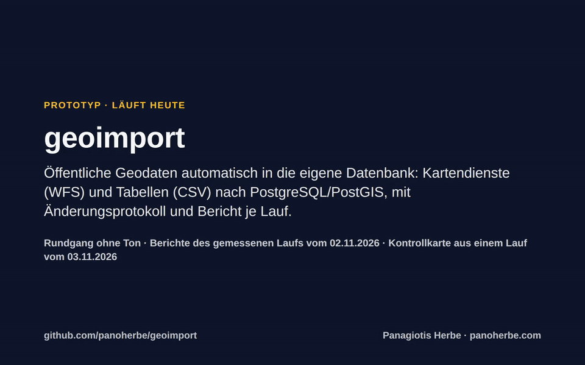
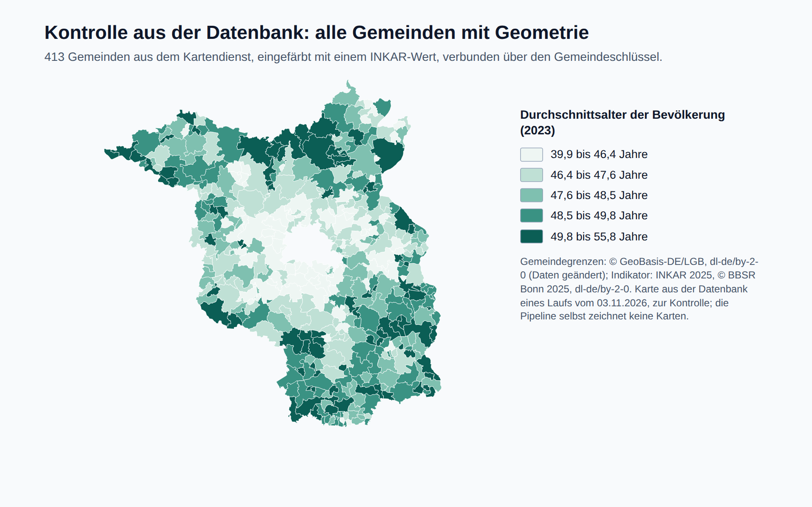
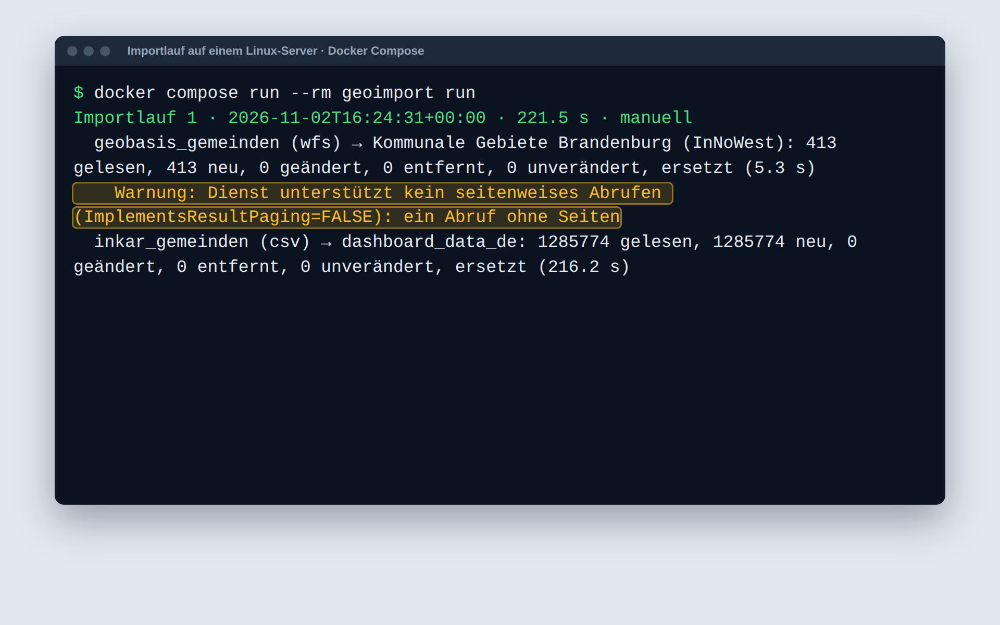
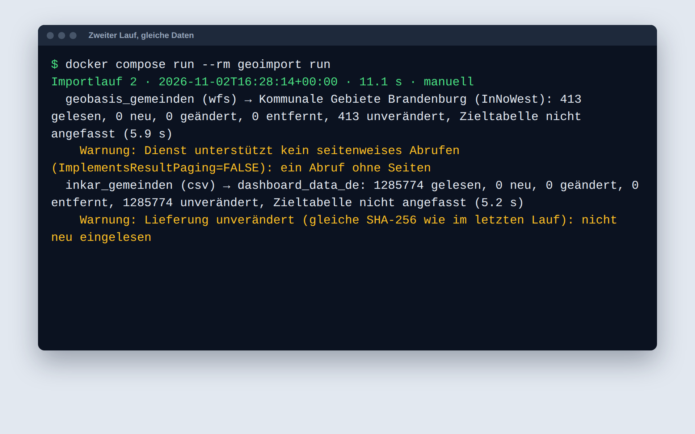

# geoimport

**Holt öffentliche Geodaten automatisch in die eigene Datenbank: Kartendienste (WFS) und Tabellen (CSV) nach
PostgreSQL/PostGIS, mit Bericht und Änderungsprotokoll je Lauf. Das läuft heute, an echten öffentlichen Quellen.**



<sub>Rundgang, 60 Sekunden, ohne Ton, mit Untertiteln. Im Terminal stehen die Berichte des gemessenen Laufs vom
02.11.2026 (Laufzeit im Zeitraffer); die Kontrollkarte stammt aus der Datenbank eines Laufs vom 03.11.2026.
[Video herunterladen (MP4, 0,9 MB)](https://github.com/panoherbe/geoimport/raw/main/medien/rundgang.mp4) · Text des
Rundgangs weiter unten.</sub>

## Was Sie brauchen → läuft hier schon

| Was Sie brauchen | läuft hier schon |
|---|---|
| Daten aus Kartendiensten (WFS) übernehmen | Gemeindegrenzen aus dem WFS der Geobasis Brandenburg: 413 Gemeinden, MULTIPOLYGON, EPSG:4326, zusammen 29.653 km² (02.11.2026) |
| Große Statistik-Tabellen (CSV) übernehmen | INKAR 2025 des BBSR, ZIP-Datei mit 434 MB, als Datenstrom gelesen: 63.426.864 Zeilen geprüft, 1.285.774 für die Gemeinden Brandenburgs übernommen, 264 Indikatoren, 1995–2024 (02.11.2026) |
| Beide Quellen passen zusammen | 413 von 413 INKAR-Gemeinden finden ihre Geometrie über den Gemeindeschlüssel (02.11.2026; am 03.11.2026 erneut 413 von 413, [Nachlauf](nachweis/2026-11-03/PROTOKOLL.md)) |
| Die vorhandenen Tabellen der Plattform bleiben, wie sie sind | schreibt in die drei bestehenden Tabellen des Datenmodells MOSIDI und ersetzt nur die Zeilen der eigenen Quelle |
| Aktualisieren, ohne etwas kaputt zu machen | zweiter Lauf 11 s: alles unverändert, keine Zieltabelle angefasst (02.11.2026); ersetzt wird nur nach vollständigem Abruf und nie, wenn mehr als 20 % einer Quelle entfallen würden |
| Nachvollziehbarkeit | jede Lieferung mit SHA-256 abgelegt, bevor sie gelesen wird; Bericht je Lauf; neu, geändert, entfernt je Objekt im Änderungsprotokoll |
| Läuft in der vorhandenen Plattform | im Compose eines frischen MOSIDI-Klons gestartet: 413 Gemeinden neu in 5 s, zweiter Lauf unverändert in 5 s (02.11.2026) |
| Neue Quellen ohne Programmierung | eine lesbare YAML-Datei je Quelle: Adresse, Filter, Schlüssel, Zieltabelle |
| Geprüfte Qualität | 9 automatische Tests grün, Einheiten- und Ende-zu-Ende-Tests gegen PostGIS (02.11.2026; erneut 9 grün am 03.11. und 04.11.2026, [Nachlauf](nachweis/2026-11-03/PROTOKOLL.md)) |
| Offen und übergabefähig | Quellcode unter AGPL-3.0, Python, Dokumentation auf Deutsch |

Messweg und Umgebung: [Testprotokoll vom 02.11.2026](nachweis/2026-11-02/PROTOKOLL.md) mit den Berichten beider Läufe
([Lauf 1](nachweis/2026-11-02/lauf-1.txt), [Lauf 2](nachweis/2026-11-02/lauf-2.txt)). Nachlauf am 03.11.2026 mit
denselben Zahlen: [nachweis/2026-11-03](nachweis/2026-11-03/PROTOKOLL.md).

## In zwei Minuten selbst prüfen

1. **Lesen, was ein Lauf liefert:** die Berichte von [Lauf 1](nachweis/2026-11-02/lauf-1.txt) und
   [Lauf 2](nachweis/2026-11-02/lauf-2.txt), je fünf Zeilen, und das [Testprotokoll](nachweis/2026-11-02/PROTOKOLL.md).
2. **Selbst laufen lassen**, mit [Docker](https://www.docker.com/products/docker-desktop/):
   ```bash
   git clone https://github.com/panoherbe/geoimport.git
   cd geoimport
   docker compose up -d brandenburg_db
   docker compose run --rm geoimport run --source geobasis_gemeinden
   ```
   Das holt die 413 Gemeinden aus dem Kartendienst und schreibt den Bericht nach `reports/`. Der Lauf über alle
   Quellen (`docker compose run --rm geoimport run`) lädt zusätzlich die INKAR-Datei mit 434 MB und dauert einige
   Minuten.
3. **Die Tests:** `docker compose run --rm test` (9 Tests).

## Ihr Vorteil: Sie bewerten ein laufendes System, kein Versprechen

- **Sie sehen vorher, dass es mit echten Quellen funktioniert:** mit dem Kartendienst der Geobasis Brandenburg und
  der INKAR-Datei des BBSR, nicht mit Beispieldaten.
- **Die Stolpersteine sind schon gefunden und gelöst:** ein Kartendienst, der nicht seitenweise liefern kann; eine
  434-MB-ZIP-Datei in einem Format, das Pythons Standardbibliothek nicht entpackt; der Gemeindeschlüssel als
  Verbindung zwischen beiden Quellen.
- **Weniger Risiko bei der Lieferung:** Datenmodell, Ablauf, Fehlerverhalten und Tests stehen; der Auftrag geht in
  Ihre Quellen, Ihre Plattform und die Übergabe.
- **Keine Bindung an einen Anbieter:** offener Quellcode (AGPL-3.0) und Dokumentation auf Deutsch.

## So sieht es aus

<table>
<tr>
<td width="50%" valign="top"><br><sub>Kontrolle aus der Datenbank: alle 413 Gemeinden mit Geometrie, eingefärbt mit einem INKAR-Wert (Durchschnittsalter 2023). Die Karte prüft den Import; die Pipeline selbst zeichnet keine Karten. Gemeindegrenzen: © GeoBasis-DE/LGB, dl-de/by-2-0 (Daten geändert); Indikator: INKAR 2025, © BBSR Bonn 2025, dl-de/by-2-0.</sub></td>
<td width="50%" valign="top"><br><sub>Bericht des ersten Laufs (02.11.2026): 413 Gemeinden und 1.285.774 INKAR-Werte neu, in 222 s. Die Warnung: Der Kartendienst kann nicht seitenweise liefern, also holt die Pipeline alles in einem Abruf.</sub><br><br><br><sub>Zweiter Lauf direkt danach: nichts geändert, nichts überschrieben, 11 s.</sub></td>
</tr>
</table>

<details>
<summary><b>Text des Rundgangs</b> (die Untertitel des Videos)</summary>

| ab | Untertitel |
|---|---|
| 0:00 | **Titel:** geoimport – öffentliche Geodaten automatisch in die eigene Datenbank: Kartendienste (WFS) und Tabellen (CSV) nach PostgreSQL/PostGIS, mit Änderungsprotokoll und Bericht je Lauf. |
| 0:04 | **Woher die Daten kommen:** Kartendienst (WFS der Geobasis Brandenburg: Gemeindegrenzen, 413 Gemeinden) · Statistik (INKAR 2025 des BBSR: 264 Indikatoren je Gemeinde, 1995–2024; Datei 434 MB gepackt) · Ziel (die vorhandenen Tabellen der Plattform MOSIDI, unverändert in ihrer Struktur) · neue Quelle (eine Datei mit Adresse, Filter und Zieltabelle, ohne Programmieren). |
| 0:09 | Ein Befehl startet den Import aller Quellen. |
| 0:12 | Jede Lieferung wird zuerst mit Prüfsumme abgelegt, dann eingelesen und abgeglichen … (Laufzeit 222 s, hier im Zeitraffer) |
| 0:16 | Fertig nach 222 Sekunden: 413 Gemeinden und 1.285.774 INKAR-Werte neu in der Datenbank. |
| 0:20 | Der Kartendienst kann nicht seitenweise liefern. Die Pipeline liest das aus seiner Selbstauskunft und holt alles in einem Abruf; vollständig ist er erst, wenn alle gemeldeten Objekte da sind. |
| 0:25 | Kontrolle: 413 Gemeinden mit Geometrie, 413 davon mit INKAR-Wert – beide Quellen passen zusammen. |
| 0:32 | Der zweite Lauf, direkt danach, mit denselben Quellen … |
| 0:35 | … 11 Sekunden: nichts geändert, also wird nichts überschrieben. Die unveränderte INKAR-Datei erkennt die Pipeline an der Prüfsumme. |
| 0:40 | Eine Quelle ist eine lesbare Datei: Adresse, Filter, Schlüssel, Zieltabelle. Neue Quellen brauchen keinen neuen Code. |
| 0:45 | **Was die Pipeline nie tut:** nie halb (ersetzt wird nur nach vollständigem Abruf, in einer Transaktion) · nie zu viel (nicht, wenn dabei mehr als 20 % einer Quelle entfallen würden) · nie alles (eine ausgefallene Quelle stoppt nur sich selbst) · nie still (je Lauf ein Bericht; neu, geändert, entfernt je Objekt im Protokoll). |
| 0:50 | **Gemessen am 02.11.2026:** 9 Tests grün · 222 s für 413 Gemeinden und 1.285.774 INKAR-Werte im ersten Lauf · 11 s im zweiten Lauf, alles unverändert · 5 s für die 413 Gemeinden im Compose eines frischen MOSIDI-Klons. |
| 0:56 | **Selbst prüfen:** Quellcode, Tests, Berichte und Testprotokoll liegen offen. Starten mit Docker: zwei Befehle. AGPL-3.0. |

</details>

## Ehrlich gesagt: Was der Prototyp noch nicht ist

Ein Prototyp, gebaut, um zu zeigen, dass der Ansatz an echten Quellen trägt. Kein fertiges Produkt.

| Heute noch nicht enthalten | Was ein Auftrag ergänzen würde |
|---|---|
| Das verbindliche Schema der Zielplattform; die Tests nutzen eine eigene, minimale Tabellendefinition nach dem Vorbild der Plattform (`tests/mosidi_tabellen.sql`) | Abgleich mit dem Schema, das der Betreiber bereitstellt, und dessen Tabellennamen in den Quelldateien |
| Suche nach dem neuesten INKAR-Jahrgang; Import der Indikator-Beschreibungen (`dashboard_data_metadata`) | beides ergänzen |
| Weitere Quellen | je Quelle eine Konfigurationsdatei, mit Test |
| Wiederholte Elemente gleichen Namens im GML werden zusammengefasst (der letzte Wert gilt) | nach Bedarf der Quellen |
| Übergabe in die Plattform mit Betriebs- und Entwicklerdokumentation | Einbau in Ihre Plattform, Dokumentation und Übergabe |

## Lizenz

Ab 04.11.2026 AGPL-3.0. Frühere Stände bis Commit [`8c364c3`](https://github.com/panoherbe/geoimport/tree/8c364c3) bleiben unter Apache-2.0. Auftraggeber erhalten im Auftrag die vertraglich vereinbarte Lizenz.

## Kontakt

Panagiotis Herbe · [panoherbe.com](https://panoherbe.com)

---

## Für Ihre IT: Technik im Detail

### Was er kann

- **WFS 2.0:** Gesamtzahl per `RESULTTYPE=hits`, seitenweiser Abruf mit `STARTINDEX`/`COUNT`, wenn der Dienst
  laut GetCapabilities Paging kann (`ImplementsResultPaging`), sonst ein einziger Abruf; wiederholt ein Dienst
  Seiten, gilt der Abruf als unvollständig. Zeitlimit je Quelle, Wiederholung bei Fehlern; GML wird nach lokalen
  Elementnamen gelesen.
- **CSV:** per URL oder als abgelegte Datei, auch im ZIP (Deflate64 über `unzip -p`, etwa INKAR), als Datenstrom;
  Filter (`Raumbezug: Gemeinden`, `Kennziffer: "12*"`), zusammengesetzte Schlüssel, Dezimalkomma.
- **Rohablage:** jede Lieferung wird vor dem Einlesen mit SHA-256 unter `data/raw/` abgelegt (die letzten fünf
  je Quelle). Eine unveränderte CSV-Lieferung wird nicht noch einmal eingelesen.
- **Zieltabellen bleiben unverändert:** Die Pipeline ersetzt nur die Zeilen ihrer Quelle (Spalte `source` oder
  die ganze Tabelle einer Geometriequelle), in einer Transaktion. Werte, die der Spaltentyp nicht annimmt, werden
  übersprungen und gemeldet. Geometrien gehen nach EPSG:4326 (bzw. in die SRID der Spalte), repariert und auf den
  Spaltentyp gebracht.
- **Änderungsprotokoll:** Abgleich je Schlüssel und Prüfsumme gegen `pipeline_meta.objekt_stand`; neu, geändert
  und entfernt je Lauf in `pipeline_meta.aenderung`. Unveränderte Quellen lassen die Zieltabelle unberührt.
- **Sicherheit:** ersetzt wird nur nach vollständigem Abruf und nie, wenn mehr als 20 % einer Quelle entfallen
  würden (einstellbar). Eine ausgefallene Quelle stoppt nur sich selbst.
- **Metadaten:** DCAT-AP-Eintrag in `table_metadata` (nur die konfigurierten Felder, dazu Zeitstempel und Ausdehnung).
- **Bericht:** `reports/lauf-<id>.json` und `.txt`, zusätzlich in `pipeline_meta.import_lauf`.
- **Dienst:** `geoimport dienst` prüft stündlich, welche Quellen fällig sind (`rhythmus_tage`), und importiert nur diese.

### Start (eigenes Compose, wie MOSIDI aufgebaut)

```bash
docker compose up -d brandenburg_db                   # postgis/postgis mit den drei MOSIDI-Tabellen
docker compose run --rm geoimport run                 # alle Quellen
docker compose run --rm geoimport run --source inkar_gemeinden --dry-run
docker compose run --rm test                          # Unit- und Ende-zu-Ende-Tests
```

Exit-Code 0 = alle Quellen erfolgreich, 1 = mindestens eine fehlgeschlagen.

### In MOSIDI einbinden

Ordner nach `services/geoimport` kopieren und in `sources/geobasis_gemeinden.yaml` unter `ziel.tabelle` den Namen der
Gemeindetabelle der Plattform eintragen, dann mit der vorhandenen `.env`:

```bash
docker compose -f docker-compose.yml -f services/geoimport/docker-compose.mosidi.yml up -d geoimport
docker compose -f docker-compose.yml -f services/geoimport/docker-compose.mosidi.yml run --rm geoimport run
```

### Neue Quelle

Eine YAML-Datei in `sources/`. Beispiele: `geobasis_gemeinden.yaml` (WFS der Geobasis Brandenburg →
Gemeindetabelle der Plattform) und `inkar_gemeinden.yaml` (INKAR → `dashboard_data_de`, `source =
INKAR`). Unter `ziel` stehen Tabelle, Quellenspalte, Geometriespalte, Spaltenabbildung (`@zeile` für eine laufende
Nummer, `@objekt_id` für den Schlüssel), feste Werte und Metadaten. Unbekannte oder fehlende Schlüssel meldet die
Pipeline vor dem ersten Abruf.

### Daten und Lizenzen

- **Gemeindegrenzen:** WFS „Verwaltungseinheiten“ (INSPIRE, ATKIS Basis-DLM) der Landesvermessung und
  Geobasisinformation Brandenburg, `https://inspire.brandenburg.de/services/au_bdlm_wfs`. © GeoBasis-DE/LGB,
  dl-de/by-2-0 (Daten geändert: auf Gemeinden gefiltert, nach EPSG:4326 umgerechnet; für die Kontrollkarte
  vereinfacht). Lizenz: [Datenlizenz Deutschland – Namensnennung – Version 2.0](https://www.govdata.de/dl-de/by-2-0),
  so angegeben in den Nutzungsbedingungen des Dienstes (GetCapabilities, `AccessConstraints`, gelesen am 04.11.2026).
- **Indikatoren:** INKAR 2025 (Indikatoren und Karten zur Raum- und Stadtentwicklung), © BBSR Bonn 2025,
  dl-de/by-2-0 ([Nutzungshinweise des BBSR](https://www.bbsr.bund.de/BBSR/DE/service/nutzungshinweise/_node.html),
  [www.bbsr.bund.de](https://www.bbsr.bund.de), gelesen am 04.11.2026). Daten geändert: auf die Gemeinden
  Brandenburgs gefiltert. Stammen einzelne Indikatoren von Dritten, gelten zusätzlich deren Bedingungen.
- Die Rohdaten sind nicht Teil des Repositorys; `geoimport run` lädt sie von den Quellen.

### Rundgang und Bilder

Die Berichte im Terminal sind die Dateien `nachweis/2026-11-02/lauf-1.txt` und `lauf-2.txt`, im Rundgang mit ihrer
echten Laufzeit im Zeitraffer abgespielt. Die Kontrollkarte stammt aus der Datenbank eines erneuten Laufs am
03.11.2026 auf demselben Server (gleiche Zahlen wie am 02.11.2026: 413 Gemeinden, 1.285.774 INKAR-Zeilen, 264
Indikatoren; [Nachlauf](nachweis/2026-11-03/PROTOKOLL.md)). Aufgenommen mit Playwright (Chromium), Untertitel
in die Seite gezeichnet, ohne Ton. Die Schlusskarte wurde am 04.11.2026 nach dem Lizenzwechsel ersetzt.

Lizenz: AGPL-3.0 (bis Commit `8c364c3` Apache-2.0). Daten: siehe „Daten und Lizenzen“.
